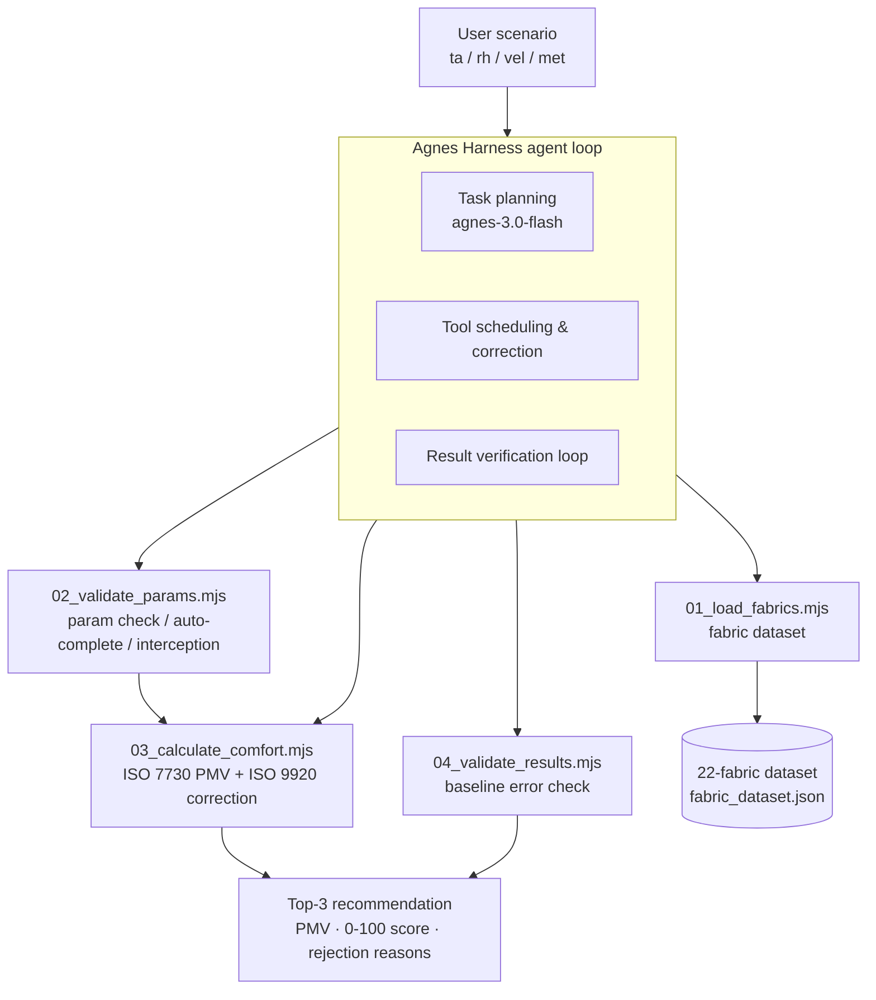

# Garment Comfort Agent — Thermal-Wet Comfort Evaluation & Fabric Selection

[English](README.md) | [简体中文](README.zh-CN.md)

> An AI agent that evaluates garment thermal-wet comfort and selects the best fabric for a given scenario, built on **Agnes Harness (AGH)** with the **agnes-3.0-flash** model.
>
> *2026 Jiangsu AI+ Science & Engineering Innovation Hackathon (University Group) · Team 陈队 (U030) · Chen Zixuan, Soochow University*

---

## 1. Project Overview

### Background
Fabric selection in fashion design and daily wear still relies on experience and manual lookup: designers query thermal/wet resistance tables by hand, and everyday wearers only judge by thickness. There is no quick way to quantify how comfortable a fabric actually feels under a given temperature, humidity, wind speed and activity level — especially in boundary conditions like hot-humid or cold-windy environments.

### Core features
- **One-scenario input, structured output**: enter air temperature, relative humidity, wind speed and activity level; the agent returns every fabric's predicted thermal sensation (PMV), a 0–100 comfort score, a **Top-3 fabric recommendation**, and rejection reasons for the rest.
- **22-fabric standardized dataset**: thermal resistance (clo), vapor resistance (ret), air permeability, grammage, thickness, suitable season and use, sourced from ISO 9920, publicly published textile engineering measurements, and national textile standards.
- **Full AGH agent loop**: problem understanding → task planning → tool calling → execution feedback → correction & error handling → result verification — with every step recorded.
- **Reliability by design**: missing parameters are auto-completed from standard scenarios; out-of-range inputs are blocked before calculation; non-converging PMV iterations are retried automatically.

### Innovation highlights
- Combines an **LLM (planning, tool scheduling, result interpretation)** with a **deterministic engineering model (ISO 7730 PMV + ISO 9920 dynamic clothing insulation correction)** — the LLM never fabricates numbers.
- **Verifiable precision**: validated against public thermal-comfort measurement data, mean absolute error **0.24 PMV** (engineering tolerance ≤ 0.35).
- **Zero dependencies**: pure Node.js, runnable anywhere Node ≥ 18 runs; every run leaves JSON logs for human audit.

---

## 2. Demo Video

**[▶ Watch the 4-minute demo video (replace with your Bilibili / YouTube link)](REPLACE_WITH_YOUR_VIDEO_LINK)**

The video walks through the real execution chain: fabric data loading → parameter auto-completion → abnormal-input interception → summer-office comfort calculation with Top-3 picks → precision verification.

A local copy of the video is included as `演示视频.mp4`; the browser demo (`双击运行演示.html`) needs no install.

---

## 3. Architecture



| Layer | Component | Responsibility |
| --- | --- | --- |
| Agent layer | Agnes Harness + agnes-3.0-flash | Understands the request, decomposes it into the 5 steps above, schedules tools, reads and explains results, retries on anomalies |
| Engineering layer | `tools/01–04` (pure Node.js) | Deterministic computation: data loading, parameter validation, PMV/comfort calculation, accuracy verification |
| Data layer | `data/*.json` | 22 standardized fabrics + 12-case validation set (6 normal / 3 boundary / 3 abnormal) |
| Evidence layer | `logs/`, `agh-trace/` | Full run logs + AGH-exported session trace (`AGH_TRACE.json` / `.html`) |

**Key engineering model**
- **ISO 7730 PMV** (Predicted Mean Vote): thermal sensation per fabric per scenario, iterated to convergence.
- **ISO 9920 dynamic clothing insulation**: effective thermal resistance is corrected for wind speed, activity level and fabric breathability — breathable fabrics lose insulation under wind/activity, windproof outer layers are not corrected.

---

## 4. Integration Standards

### Interface contract
Every tool is a standalone CLI that reads named arguments and writes **JSON to stdout** — callable from any agent runtime, script or web service:

```bash
# 1. Load the 22-fabric dataset
node tools/01_load_fabrics.mjs

# 2. Validate / auto-complete / intercept parameters
node tools/02_validate_params.mjs --ta=26        # missing params auto-completed
node tools/02_validate_params.mjs --ta=80        # out-of-range → exit code 1

# 3. Evaluate comfort and rank fabrics
node tools/03_calculate_comfort.mjs --ta=26 --rh=50 --vel=0.1 --met=1.1

# 4. Run accuracy verification
node tools/04_validate_results.mjs
```

| Parameter | Flag | Unit | Default | Notes |
| --- | --- | --- | --- | --- |
| Air temperature | `--ta` | ℃ | required | valid range −40 ~ 50 |
| Relative humidity | `--rh` | % | 50 | auto-completed if omitted |
| Wind speed | `--vel` | m/s | 0.1 | indoor no-wind assumption |
| Activity level | `--met` | met | 1.1 | sitting/office baseline |

### Output schema (excerpt, JSON on stdout)
```json
{
  "success": true,
  "scene": { "temperature": 26, "humidity": 50, "wind_speed": 0.1, "activity_met": 1.1 },
  "total_calculated": 22,
  "top_recommended": [
    { "id": "F003", "name": "亚麻平布", "pmv": 0.01, "comfort_score": 100, "sensation": "舒适" }
  ]
}
```

### Standards referenced
- **ISO 7730** — analytical determination and interpretation of thermal comfort (PMV/PPD).
- **ISO 9920** — ergonomics of the thermal environment (clothing insulation and evaporative resistance).
- Model credentials (Agnes API key) are read from the `AGNES_API_KEY` environment variable only — **never hard-coded or committed**.

### Reproducibility
```bash
git clone <your-repo-url> && cd garment-comfort-agent
node tools/01_load_fabrics.mjs && node tools/04_validate_results.mjs
# Expected: mean absolute error 0.24, within the 0.35 engineering threshold
```

---

## Repository structure
```
garment-comfort-agent/
├── data/                # 22-fabric dataset + validation dataset
├── tools/                # 01 load → 02 validate → 03 comfort → 04 verify (+ 05 model call)
├── logs/                # execution logs + AGH execution record
├── agh-trace/           # AGH-exported trace (JSON event stream + HTML viewer)
├── 演示视频.mp4          # 4-minute demo video
├── 双击运行演示.html     # browser interactive demo (no install)
├── README.md             # this file (English)
└── README.zh-CN.md      # Chinese version
```

## Results at a glance
| Metric | Value |
| --- | --- |
| Fabrics in dataset | 22 (F001–F022, summer / spring-autumn / winter) |
| Validation cases | 6 normal + 3 boundary + 3 abnormal |
| Mean absolute error (PMV) | **0.24** (threshold ≤ 0.35) |
| Agent model | agnes-3.0-flash via Agnes Harness |

## License
MIT — free for study and reuse. Data files are derived from public standards and published measurements; see 第三方素材来源说明.md for citations.
