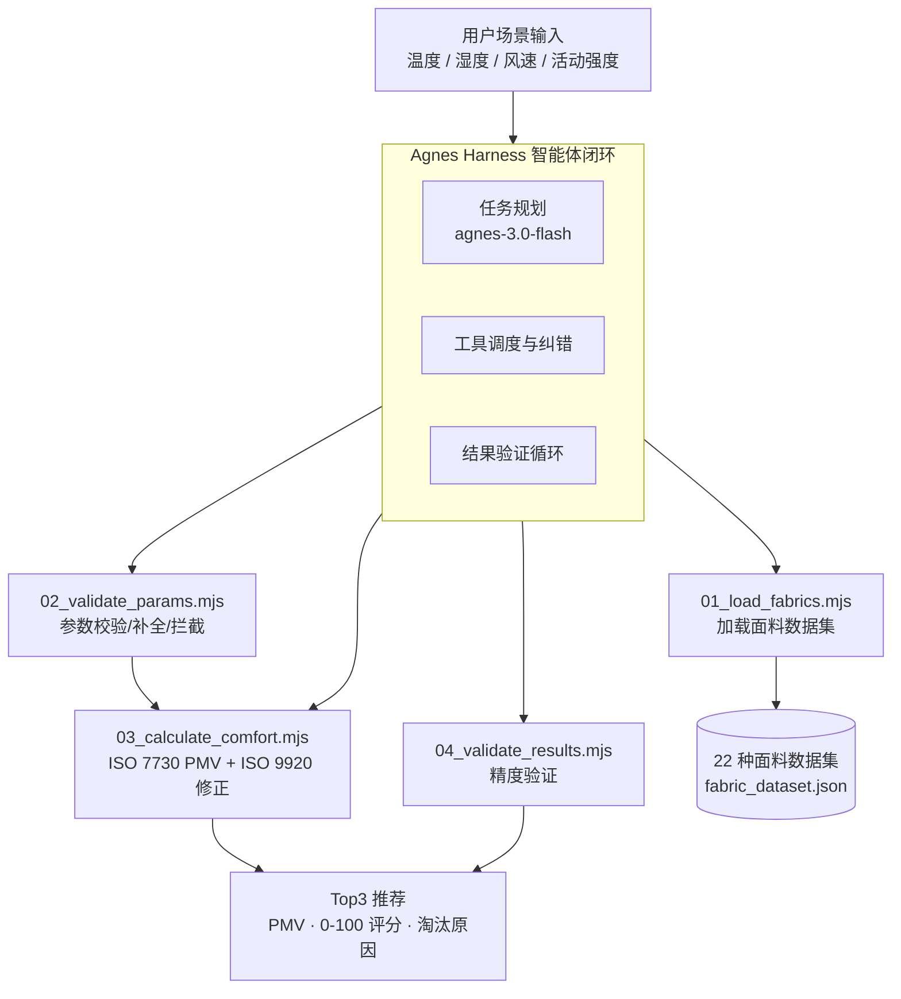

# 服装舒适性智能评估与面料选型 Agent

[English](README.md) | [简体中文](README.zh-CN.md)

> 基于 **Agnes Harness（AGH）** 与 **agnes-3.0-flash** 模型构建的服装热湿舒适性智能评估与面料选型智能体。
>
> *2026 年江苏省 AI+科学与工程创新实践黑客松（高校组）· 陈队（参赛编号 U030）· 苏州大学 陈子轩*

---

## 1. 项目介绍（Project Overview）

### 项目背景
服装设计与日常选衣长期依赖经验：设计师要人工查表、逐样测试面料的热阻与湿阻；普通用户只凭厚度判断，经常"穿多闷热、穿少发冷"。面对高温高湿、低温大风等边界场景，更缺少一种快速量化"这件衣服在这个环境下舒不舒服"的手段。

### 核心功能
- **输入场景，输出结构化结论**：输入温度、相对湿度、风速、活动强度，即可得到每种面料的预测热感（PMV）与 0–100 舒适评分，输出 **Top3 面料推荐**及其余面料的淘汰原因（偏冷 / 偏热 / 透气不足）。
- **22 种面料标准化数据集**：包含热阻(clo)、蒸气阻(ret)、透气性、克重、厚度、适用季节与用途，数据来自 ISO 9920 标准、公开纺织工程论文实测数据与国家纺织标准。
- **完整 AGH 智能体闭环**：问题理解 → 任务规划 → 工具调用 → 执行反馈 → 调整纠错 → 结果验证，每一步均有执行记录。
- **可靠性设计**：缺失参数按标准场景自动补全并提示；超出合理范围的输入在计算前直接拦截；PMV 迭代不收敛时自动调整重算。

### 创新亮点
- **大模型负责"会做事"，工程模型负责"算得准"**：Agnes 模型负责任务规划、工具调度与结果解读，ISO 7730 PMV 模型负责定量计算，模型绝不编造数字。
- **精度可验证**：基于公开热舒适实测数据基线，平均绝对误差 **0.24 PMV**，低于工程允许阈值 0.35。
- **零依赖可复现**：纯 Node.js 实现，Node ≥ 18 即可运行，每次运行输出 JSON 并留存日志，可供人工逐条核查。

---

## 2. 视频介绍（Demo Video）

**[▶ 观看 4 分钟演示视频（替换成你的 B 站 / 视频链接）](演示视频.mp4)**

视频完整演示真实执行链：面料数据加载 → 参数自动补全 → 异常参数拦截 → 夏季办公室场景舒适计算与 Top3 推荐 → 精度验证。

项目内附视频文件 `演示视频.mp4`；`双击运行演示.html` 为浏览器内交互演示，无需安装任何环境。

---

## 3. 架构介绍（Architecture）



| 层级 | 组件 | 职责 |
| --- | --- | --- |
| 智能体层 | Agnes Harness + agnes-3.0-flash | 理解需求、拆解任务、调度工具、解读结果、处理异常 |
| 工程计算层 | `tools/01–04`（纯 Node.js） | 确定性计算：数据加载、参数校验、PMV 舒适计算、精度验证 |
| 数据层 | `data/*.json` | 22 种标准化面料 + 12 例验证集（正常 6 / 边界 3 / 异常 3） |
| 证据层 | `logs/`、`agh-trace/` | 全量运行日志 + AGH 导出的会话 trace（`AGH_TRACE.json` / `.html`） |

**核心工程模型**
- **ISO 7730 PMV**（预测平均热感）：逐面料迭代计算至收敛，输出热感值与舒适评分。
- **ISO 9920 服装热阻动态修正**：根据风速、活动强度与面料防风属性修正有效热阻——透气面料受风/活动影响自动降低热阻，防风厚外套不做穿透修正。

---

## 4. 集成标准（Integration Standards）

### 接口规范
每个工具都是独立命令行程序，读取命名参数、向标准输出写 **JSON**，可被任意智能体运行时、脚本或 Web 服务直接调用：

```bash
# 1. 加载 22 种面料数据集
node tools/01_load_fabrics.mjs

# 2. 参数校验（缺失自动补全 / 越界拦截）
node tools/02_validate_params.mjs --ta=26        # 缺参自动补全
node tools/02_validate_params.mjs --ta=80       # 超出范围 → 退出码 1

# 3. 舒适计算与面料排序
node tools/03_calculate_comfort.mjs --ta=26 --rh=50 --vel=0.1 --met=1.1

# 4. 运行精度验证
node tools/04_validate_results.mjs
```

| 参数 | 命令行参数 | 单位 | 默认值 | 说明 |
| --- | --- | --- | --- | --- |
| 空气温度 | `--ta` | ℃ | 必填 | 合法范围 −40 ~ 50 |
| 相对湿度 | `--rh` | % | 50 | 缺省时自动补全 |
| 风速 | `--vel` | m/s | 0.1 | 室内无风假设 |
| 活动强度 | `--met` | met | 1.1 | 静坐办公基线 |

### 输出结构（标准输出 JSON 节选）
```json
{
  "success": true,
  "scene": { "temperature": 26, "humidity": 50, "wind_speed": 0.1, "activity_met": 1.1 },
  "total_calculated": 22,
  "top_recommended": [
    { "id": "F003", "name": "亚麻平布", "pmv": 0.01, "comfort_score": 100, "sensation": "舒适" }
  ]
}
```

### 遵循标准
- **ISO 7730** — 热舒适分析（PMV/PPD）。
- **ISO 9920** — 热环境工效学（服装热阻与蒸发阻力）。
- Agnes 模型密钥仅通过环境变量 `AGNES_API_KEY` 读取，**绝不硬编码、不写入提交与公开仓库**。

### 复现方式
```bash
git clone <你的仓库地址> && cd garment-comfort-agent
node tools/01_load_fabrics.mjs && node tools/04_validate_results.mjs
# 预期：平均绝对误差 0.24，低于 0.35 工程阈值
```

---

## 仓库结构
```
garment-comfort-agent/
├── data/                # 22 种面料数据集 + 验证数据集
├── tools/               # 01 加载 → 02 校验 → 03 计算 → 04 验证（+ 05 模型调用）
├── logs/                # 执行日志 + AGH 执行记录
├── agh-trace/           # AGH 导出的 trace（JSON 事件流 + HTML 查看版）
├── 演示视频.mp4          # 4 分钟演示视频
├── 双击运行演示.html     # 浏览器交互演示（无需安装）
├── README.md            # 英文版（GitHub 默认展示）
└── README.zh-CN.md      # 本文件（中文版）
```

## 结果一览
| 指标 | 数值 |
| --- | --- |
| 数据面料 | 22 种（F001–F022，覆盖夏/春秋/冬） |
| 验证用例 | 正常 6 + 边界 3 + 异常 3 |
| 平均绝对误差（PMV） | **0.24**（阈值 ≤ 0.35） |
| 智能体模型 | agnes-3.0-flash（经 Agnes Harness 调度） |

## 开源协议
MIT —— 可自由学习与复用。数据文件来源于公开标准与已发表实测，引用见 第三方素材来源说明.md。
